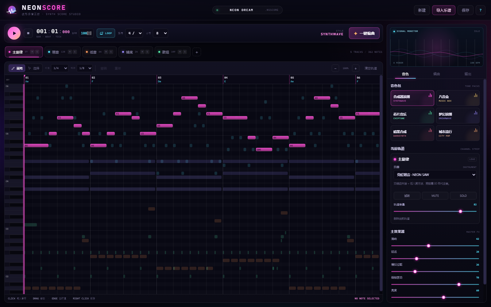

# 怎么打开这个软件

这是一个不用安装的音乐软件。你只要打开文件夹，双击里面的 **`打开 NEONSCORE.bat`**，它就会在浏览器里打开。

> 第一次打开时，Windows 可能会弹出一个蓝色提示，说这个文件“不是来自应用商店”。这是正常的，因为它是一个本地小工具。点 **“更多信息” → “仍要运行”** 就可以。  
> 如果不想用这个 `.bat`，也可以直接双击文件夹里的 **`index.html`**。

打开后，你会看到一个深色的音乐工作台。不需要注册，不需要登录，也不需要联网。

---

## 怎么导入一首 MIDI

1. 点击右上角的 **“导入乐谱”**。
2. 点击 **“选择本地乐谱文件”**。
3. 在电脑里找到你的 MIDI 文件（文件名通常以 `.mid` 结尾），选中它。
4. 等一两秒，画面里出现彩色的音符条，就表示导入成功。
5. 按键盘上的 **空格键**，或者点左上角的圆形播放按钮，就能听到音乐。

如果你没有 MIDI 文件，也可以点 **“导入乐谱”**，在 **“示例谱库”** 里直接选一首示例来试听。

---

## 怎么导出 WAV

1. 看右边的面板，点击 **“输出”**。
2. 点击 **“渲染并下载 WAV”**。
3. 等进度条走完。时间长短取决于曲子长度，通常几秒到几十秒。
4. 浏览器会把文件下载到你的 **“下载”** 文件夹。
5. 想整理的话，把下载好的 `.wav` 文件拖到本文件夹里的 **`scores/output`** 文件夹即可。

WAV 是普通音频文件，可以拖进视频剪辑软件、音乐软件，或者直接发给朋友。

---

## 怎么保存工程

点击右上角的 **“保存”**，会下载一个工程文件。下次想继续编辑时，点 **“导入乐谱” → “打开工程文件”**，选中它就能接着改。

---

## 简单编辑

- 在中间的格子上点一下，就会写下一个音符。
- 按住音符拖动，可以改音高和位置。
- 拖音符的右边，可以改长短。
- 右键点音符，可以删除。
- 选中一个音符后，按键盘上的 **H**，软件会自动帮你配一个和弦。
- 右边的 **“音色”** 可以换乐器；**“一键编曲”** 会自动加鼓、贝斯和伴奏。

---

## 这个软件会动我的电脑吗？

不会。

- 它不会把你的乐谱上传到网上。
- 它不会下载和执行网上的程序。
- 它不会删除你电脑上的文件。
- 它只会读取你主动选择导入的那个乐谱文件。
- 它不需要安装，也不会自动更新。

你可以断网使用。它只是一个放在文件夹里的网页工具。

---

## 需要注意的地方

1. **整个文件夹要放在一起。** 不要只把 `index.html` 单独拿走，`js`、`css`、`scores` 这些子文件夹要留在旁边。
2. 如果要换电脑，把整个 `NeonScore_MusicProject` 文件夹复制过去，双击打开即可。
3. `scores/Touhou` 里的东方改编工程是从你提供的 MIDI 做的本地练习，原曲版权属于 ZUN / Team Shanghai Alice；自己听和改可以，请不要公开传播这个改编文件。
4. 如果页面打开是空白的，先刷新一次；还不行就确认 `js` 文件夹还在原位置。
5. 这个软件不能把图片或 PDF 乐谱自动“扫描”成音符。如果你只有图片谱，需要先找人转成 MIDI 或 MusicXML。
