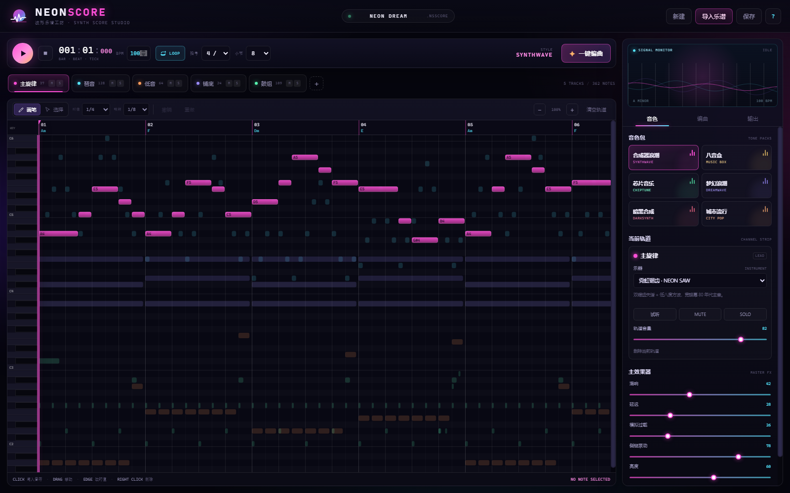

# NEONSCORE · 波形乐谱工坊

> **NeonScore Music Project** · v0.1.0 · 2026-11-15
> 浏览器里的合成器乐谱工作站：导入乐谱 / 手写乐谱 / 自动编曲 / 多种音色 / 渲染 WAV。

一个运行在浏览器里的合成器乐谱工作站：**导入乐谱 / 手写乐谱 / 自动编曲 / 多种音色 / 渲染 WAV**。

纯 HTML + CSS + JavaScript，无构建步骤、无外部依赖、无需联网。双击 `index.html`（或 `打开 NEONSCORE.bat`）即可使用。



- [给非程序员：怎么打开、导入 MIDI、导出 WAV](HOW-TO-OPEN.md)
- [开发日志](docs/DEVELOPMENT.md)
- [安全自查报告](docs/SECURITY-AUDIT.md)
- [更新记录](CHANGELOG.md)
- [文本谱格式](scores/NST-FORMAT.md)
- [乐谱目录说明](scores/README.md)

## 快速开始

1. 双击 `打开 NEONSCORE.bat` 或 `index.html`。
2. 默认会载入 `NEON DREAM` 示例。按 **空格** 播放。
3. 点顶部 **导入乐谱**：
   - 选择内置示例（Synthwave / 八音盒 / Chiptune / 本地东方工程）；
   - 或选择 `.nst`、`.txt`、`.mid`、`.musicxml`、`.mxl`、`.nsscore.json`。
4. 在钢琴卷帘上点一下写音符，拖右边缘改长度，选中后按 `H` 自动配和弦。
5. 右侧「音色」换乐器，「编曲」调织体，「一键编曲」重写伴奏。
6. 「输出」里渲染 WAV、导出 MIDI / `.nst` / 工程 JSON。

## 主要功能

### 钢琴卷帘

- 点击写入，拖动移动，拖右边缘改时值，右键 / 双击删除。
- 每条轨道可独立选音色、调音量、静音、独奏。
- 动态音域：导入高音旋律或超低贝斯时，会自动扩展显示范围并支持纵向滚动。
- 撤销 / 重做、复制、方向键微调、缩放、吸附、播放头跟随。
- 轨道颜色、和弦标记、其他轨道幽灵音符。

### 音色库

- 主音：霓虹锯齿、方波英雄、八音盒、水晶主音、呼吸长笛、芯片主音、FM 电钢琴。
- 琶音：玻璃琶音、模拟拨弦、星尘钟琴、芯片琶音、木质马林巴。
- 低音：模拟贝斯、深潜低音、FM 贝斯、三角芯片贝斯、橡胶贝斯。
- 铺底：暖色铺底、玻璃云层、合成弦乐、暗色铺底、迷幻风琴、芯片铺底。
- 鼓组：门限 80s、录音室 84、808 鼓机、芯片鼓组、磁带鼓组。
- 六个音色包：**Synthwave、八音盒、Chiptune、Dreamwave、Darksynth、City Pop**。

### 自动编曲与自动和弦

- 「一键编曲」根据和弦走向生成贝斯、琶音、铺底、鼓组；主旋律为空时自动作曲。
- 选中一个根音，点「为选中根音配和弦」或按 `H`，自动补全三和弦 / 七和弦并写入铺底轨道。
- 文本谱里写 `chords: Cm | Ab | Fm | G`，每小节自动生成和弦。
- 文本谱里写 `C5:maj7`，自动展开成 C E G B。

### 文本谱 `.nst`

纯文本、UTF-8，VSCode / 记事本可写。完整语法见 [`scores/NST-FORMAT.md`](scores/NST-FORMAT.md)。

```nst
title: My Track
tempo: 108
meter: 4/4
bars: 8
key: C minor
style: synthwave

track lead "主旋律" instrument=neonSaw volume=90
@1:1 C5/8
@1:1.5 D5/8
@1:2 Eb5/4
@2:1 C5/2 v=110

track pad "自动和弦" instrument=warmPad volume=65
chords: Cm | Ab | Fm | G
```

- `@小节:拍` 绝对定位：改一个音不会让后面全部顺移。
- `/4` 四分音符、`/8` 八分音符、`/2` 二分音符；也支持 `:1.5` 直接写拍数。
- `v=0..127` 力度；`[C5,E5,G5]` 显式和弦；`K/S/H/O/C/T/CR` 鼓组简写。
- 支持 `track ... instrument=... volume=...` 多轨。
- 导出会保留所有轨道、每个音的起点/长度/力度，适合从 MIDI 导入后再精修。
- `editors/vscode-nst/` 附带一个最小 VS Code 扩展（语法高亮 + 片段）。

### 导入

- MIDI：多轨、多通道、鼓组、速度、拍号；自动识别常见乐器角色。
- MusicXML：`.musicxml` / `.xml` / `.mxl`（内置 ZIP 解压）。
- 文本谱：`.nst` / `.txt`。
- 工程：`.nsscore.json`。
- 不支持扫描图片 / PDF 的 OMR 识谱，请先转换成 MusicXML 或 MIDI。

### 导出

- **WAV**：44.1kHz / 16bit 立体声，离线渲染，含混响、延迟、门限混响、侧链与母带压缩。
- **MIDI**：可回到 DAW / 制谱软件继续编辑。
- **NST**：绝对定位文本谱，可用 VSCode / 记事本继续写。
- **工程 JSON**：保留全部音色、和弦、效果与轨道状态。

## 目录

```
NeonScore_MusicProject/          ← git 仓库根目录
  index.html
  打开 NEONSCORE.bat
  README.md / CHANGELOG.md / LICENSE
  HOW-TO-OPEN.md          # 给非程序员的打开 / 导入 / 导出说明
  css/style.css
  js/                    # 乐理、音色、合成器、导入器、编辑器
  scores/                # 乐谱输入输出 + 示例谱库 + 格式文档
    NST-FORMAT.md
    library.js
    local-library.js
    Touhou/              # th06_05 本地编辑工程
  TouhouMid/             # 用户提供的东方 MIDI 源文件
  editors/vscode-nst/    # VS Code 语法高亮扩展
  tools/                 # 示例生成脚本
  docs/
    preview.png
    DEVELOPMENT.md       # 开发日志 / 架构决策 / 路线图
    SECURITY-AUDIT.md    # 安全自查报告
```

## 开发工作流

```powershell
# 直接运行
.\打开 NEONSCORE.bat

# 重新生成三套「東方連復段」示例 + MIDI
node tools/build-samples.js

# 重新生成 th06_05 本地编辑工程与 LOCAL 示例
node tools/build-touhou-edit.js
```

- 本项目没有运行时 npm 依赖，不需要 `npm install`。
- 修改 `js/` 后刷新浏览器即可；没有打包步骤。
- `.gitignore` 已排除测试截图、浏览器 profile、`scores/output/` 输出和 Node 构建产物。
- 提交前建议跑一次 `docs/SECURITY-AUDIT.md` 中的检查清单。

## 示例与版权

- 内置「東方連復段」示例的旋律参考 [Wikimedia Commons: AsianRiffSheetMusic](https://commons.wikimedia.org/wiki/File:AsianRiffSheetMusic.png)（CC BY-SA 3.0）。编曲、音色与鼓组为本工程原创改编；再分发时请保留署名与相同方式共享。
- `scores/Touhou/` 中的「おてんば恋娘」编辑工程来自用户提供的 `TouhouMid/th06_05.mid`。原曲版权归 **ZUN / Team Shanghai Alice**，仅供本地个人学习与编辑，请勿再分发该改编文件。
- 代码以根目录 [`LICENSE`](LICENSE)（MIT）授权；示例旋律的许可以上一条为准。

## 已知限制

- 图片 / PDF 谱不能直接识谱。
- MIDI 的速度 / 拍号变化会按第一组速度与拍号处理，不保留曲中变速。
- MIDI 文本元数据优先按 UTF-8 解码，失败时尝试 Shift-JIS。
- 浏览器不能直接写入 `scores/output/`，导出后请手动移动下载文件。
- 极大的 MIDI（数千音符、十几轨）会自动提高音域并增量调度音频，但画布仍可能较重。

## 贡献与记录

- 架构、关键决策、已完成/待办事项：见 [`docs/DEVELOPMENT.md`](docs/DEVELOPMENT.md)。
- 版本变更：见 [`CHANGELOG.md`](CHANGELOG.md)。
- 安全相关改动与审计结论：见 [`docs/SECURITY-AUDIT.md`](docs/SECURITY-AUDIT.md)。
- 安全问题的修复原则：先报告、最小改动、保留乐谱生成核心功能；不把用户乐谱或本地路径发到网络。

## 开发 / 重新生成示例

```powershell
node tools/build-samples.js       # 三套「東方連復段」示例 + MIDI
node tools/build-touhou-edit.js   # th06_05 本地编辑工程与 LOCAL 示例
```

无需 npm 安装。直接用浏览器打开 `index.html` 即可调试。
